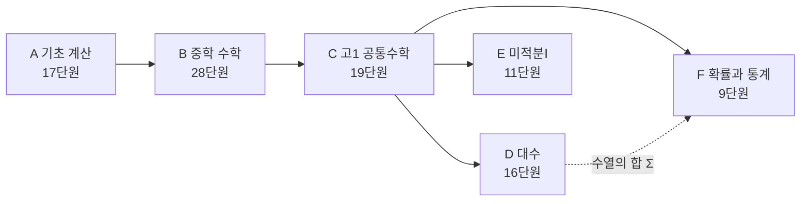

# Math Hub 학습 지도

초등 계산에서 시작해 2028학년도 이후 수능 수학(대수, 미적분Ⅰ, 확률과 통계)까지 가는 전체 단원 목록이다.
단원은 모두 100개이고, 각 단원에는 **먼저 통과해야 하는 단원(선수 단원)** 이 적혀 있다.

- 이 문서는 계획이다. 실제 앱이 읽는 데이터는 `docs/shared/map.js` 로 옮긴다(형식은 [architecture.md](architecture.md) 2장).
- 단원은 한 번에 하나씩, 요청받은 것만 만든다. 이 목록에 있다고 미리 만들지 않는다.
- 범위는 2022 개정 교육과정을 기준으로 잡았다. 단원을 실제로 만들 때 교육과정 문서로 세부 범위를 한 번 더 확인한다. 특히 기억에 의존한 부분은 표에 `확인`이라고 적었다.

## 읽는 법

| 표시 | 뜻 |
|---|---|
| `A01` | 단원 ID. 글자는 구간(A~F), 숫자는 권장 순서. 한 번 정하면 바꾸지 않는다(학습 기록의 열쇠). |
| 선수 단원 | 이 단원을 열기 전에 통과해야 하는 단원. 바로 앞 단계만 적었다(선수의 선수는 생략). |
| `+` | 요청한 목록에는 없었지만 뒤 단원에 꼭 필요해서 넣자고 제안하는 단원. |
| `선택` | 건너뛰어도 수능 범위까지 가는 데 지장이 없는 단원. |

## 구간 흐름

- D, E, F는 서로 거의 독립이라 C를 마치면 어느 것부터 해도 된다. 권장 순서는 D → E → F.
- 예외는 하나: F06(확률분포)은 D15(수열의 합 Σ)를 먼저 알아야 한다.
- F01~F05(경우의 수, 확률)는 C10(순열과 조합)만 통과하면 시작할 수 있어서, 대수·미적분과 번갈아 하기 좋다.

---

## A. 기초 계산 (초등) — 17단원

목표: 분수와 소수의 사칙연산을 막힘 없이 한다. 이후 모든 구간의 계산 바탕이다.

| ID | 단원 | 주요 내용 | 선수 단원 |
|---|---|---|---|
| A01 | 덧셈과 뺄셈 점검 `+` | 받아올림·받아내림이 있는 두~세 자리 덧셈·뺄셈 | 없음 |
| A02 | 곱셈구구 | 2~9단, 순서 섞어서, 빈칸 찾기(□×7=56) | 없음 |
| A03 | 곱셈 `+` | (두·세 자리)×(한 자리), (두 자리)×(두 자리) | A01, A02 |
| A04 | 나눗셈 ① 나누어떨어지는 나눗셈 | 곱셈구구 범위의 나눗셈, 곱셈과 나눗셈의 관계 | A02 |
| A05 | 나눗셈 ② 몫과 나머지 | 나머지가 있는 나눗셈, (두·세 자리)÷(한·두 자리), 검산 | A03, A04 |
| A06 | 혼합 계산의 순서 `+` | 곱셈·나눗셈 먼저, 괄호 먼저 | A03, A04 |
| A07 | 약수와 배수 `+` | 약수, 배수, 최대공약수, 최소공배수 | A04 |
| A08 | 분수의 뜻 | 전체와 부분, 진분수·가분수·대분수 바꾸기, 수직선, 나눗셈의 몫으로서의 분수 | A04 |
| A09 | 약분과 통분 | 크기가 같은 분수, 기약분수, 통분, 분수의 크기 비교 | A07, A08 |
| A10 | 분수의 덧셈과 뺄셈 | 분모가 같은 경우 → 다른 경우 → 대분수 | A09 |
| A11 | 분수의 곱셈 | (분수)×(자연수), (분수)×(분수), 계산 중 약분 | A09 |
| A12 | 분수의 나눗셈 | 역수, (분수)÷(자연수), (분수)÷(분수) | A11 |
| A13 | 소수의 뜻과 덧셈·뺄셈 `+` | 자릿값, 소수의 크기 비교, 자리 맞춰 더하고 빼기 | A01, A08 |
| A14 | 소수의 곱셈과 나눗셈 `+` | 소수점 위치, (소수)×(소수), (소수)÷(자연수·소수) | A05, A13 |
| A15 | 분수 ↔ 소수 | 분수를 소수로(유한소수가 되는 것만), 소수를 기약분수로 | A05, A09, A13 |
| A16 | 비와 비율 `+` | 비, 비율, 백분율, 비례식 | A11, A15 |
| A17 | 분수·소수 혼합 계산 | 분수와 소수가 섞인 사칙 혼합 계산(구간 마무리) | A06, A10, A12, A14, A15 |

`+` 단원을 넣은 이유:
- A01: 뒤의 모든 계산에 쓰인다. 이미 잘하면 10문제로 바로 통과하고 넘어가는 점검 단원이다.
- A03, A05의 큰 수 계산: 통분·소수 나눗셈에서 두 자리 곱셈·나눗셈이 계속 나온다.
- A06: 중학교 정수·유리수 혼합 계산의 전제.
- A07: 약분(최대공약수)과 통분(최소공배수)의 전제.
- A13, A14: "분수 ↔ 소수"를 하려면 소수 자체를 먼저 다룰 수 있어야 한다.
- A16: 정비례·반비례, 일차방정식 활용, 확률에 쓰인다.

## B. 중학 수학 — 28단원

목표: 문자를 쓰는 계산, 방정식, 함수의 그래프. 도형과 통계는 수능 범위에 실제로 쓰이는 것만 추렸다.

| ID | 단원 | 주요 내용 | 선수 단원 |
|---|---|---|---|
| B01 | 소인수분해 | 소수, 거듭제곱, 소인수분해로 최대공약수·최소공배수 구하기 | A07 |
| B02 | 정수와 유리수의 뜻 | 음수, 수직선, 절댓값, 대소 관계 | A09, A15 |
| B03 | 정수와 유리수의 덧셈·뺄셈 | 부호가 다른 수의 덧셈, 뺄셈을 덧셈으로 | B02, A10 |
| B04 | 정수와 유리수의 곱셈·나눗셈 | 부호 규칙, 거듭제곱, 사칙 혼합 계산 | B03, A12, A06 |
| B05 | 문자의 사용과 식의 값 | 곱셈·나눗셈 기호 생략, 식의 값 대입 | B04 |
| B06 | 일차식의 계산 | 항·계수·차수, 동류항, 분배법칙 | B05 |
| B07 | 일차방정식 | 등식의 성질, 이항, 계수가 분수·소수인 방정식 | B06 |
| B08 | 일차방정식의 활용 | 문장을 식으로 옮기기(수, 거리·속력·시간, 농도, 가격) | B07, A16 |
| B09 | 좌표평면과 정비례·반비례 | 순서쌍, 사분면, 그래프 읽기, y=ax, y=a/x | B05, A16 |
| B10 | 유리수와 순환소수 | 유한소수가 되는 조건, 순환소수를 분수로 | A15, B01 |
| B11 | 지수법칙과 단항식의 계산 | 지수법칙, 단항식의 곱셈·나눗셈 | B01, B06 |
| B12 | 다항식의 계산 | 다항식의 덧셈·뺄셈, (단항식)×(다항식), (다항식)÷(단항식) | B11 |
| B13 | 일차부등식 | 부등식의 성질(음수를 곱하면 방향이 바뀜), 풀이와 활용 | B07 |
| B14 | 연립일차방정식 | 가감법, 대입법, 활용 | B07, B12 |
| B15 | 일차함수와 그래프 | 함수의 뜻, 기울기, 절편, 직선의 식 구하기 | B09, B07 |
| B16 | 일차함수와 일차방정식 | 직선의 방정식, 두 직선의 교점과 연립방정식의 해 | B14, B15 |
| B17 | 제곱근과 실수 | 제곱근의 뜻, 무리수, 실수의 대소 관계 | B10, B11 |
| B18 | 근호를 포함한 식의 계산 | 근호의 곱셈·나눗셈, 분모의 유리화, 덧셈·뺄셈 | B17, B12 |
| B19 | 다항식의 곱셈 | 전개, 곱셈 공식 | B12 |
| B20 | 인수분해 | 공통인수, 인수분해 공식, x²+bx+c, ax²+bx+c | B19, B01 |
| B21 | 이차방정식 | 인수분해·제곱근·완전제곱식 풀이, 근의 공식, 활용 | B20, B18 |
| B22 | 이차함수와 그래프 | y=ax², 평행이동, 꼭짓점과 축, 일반형을 표준형으로 | B15, B21 |
| B23 | 도형의 기초 | 각과 평행선, 삼각형·사각형의 성질, 다각형의 각, 넓이, 원과 부채꼴 | A17, B07 |
| B24 | 닮음과 피타고라스 정리 | 닮음비, 넓이의 비, 피타고라스 정리 | B23, B17, A16 |
| B25 | 삼각비 | sin·cos·tan의 뜻, 30°·45°·60°의 값, 길이와 넓이 구하기 | B24, B18 |
| B26 | 원의 성질 | 현과 접선, 원주각과 중심각 | B23, B24 |
| B27 | 경우의 수와 확률 기초 | 사건과 경우의 수, 확률의 뜻과 기본 성질 | A09, A16 |
| B28 | 대푯값과 산포도 | 평균·중앙값·최빈값, 편차, 분산, 표준편차 | B04, B17 |

뺀 것: 작도와 합동 조건, 입체도형의 겉넓이·부피, 삼각형의 외심·내심, 도수분포표·상자그림·산점도. 수능 범위의 선수 단원으로 쓰이지 않아 넣지 않았다. 필요하면 나중에 `선택` 단원으로 추가한다.

## C. 고1 공통수학 — 19단원

공통수학1(C01~C11)과 공통수학2(C12~C19). 수능에 직접 출제되는 범위는 아니지만 D·E·F의 거의 모든 단원이 여기에 기대고 있다.

| ID | 단원 | 주요 내용 | 선수 단원 |
|---|---|---|---|
| C01 | 다항식의 연산 | 덧셈·곱셈, 곱셈 공식의 확장(세제곱 등), 다항식의 나눗셈 | B12, B19 |
| C02 | 항등식과 나머지정리 | 항등식(계수 비교, 수치 대입), 나머지정리, 인수정리, 조립제법 | C01 |
| C03 | 인수분해 | 세제곱 공식, 치환, 인수정리를 이용한 고차식 인수분해 | C02, B20 |
| C04 | 복소수 | 허수단위 i, 복소수의 사칙연산, 켤레복소수 | B18, B21 |
| C05 | 이차방정식 | 판별식, 근과 계수의 관계 | C04, B21 |
| C06 | 이차방정식과 이차함수 | 그래프와 x축·직선의 위치 관계, 제한된 범위의 최대·최소 | C05, B22 |
| C07 | 여러 가지 방정식 | 삼차·사차방정식, 연립이차방정식 | C03, C05, B14 |
| C08 | 여러 가지 부등식 | 연립일차부등식, 절댓값을 포함한 부등식, 이차부등식 | B13, C06 |
| C09 | 경우의 수 | 합의 법칙, 곱의 법칙 | B27 |
| C10 | 순열과 조합 | 순열 nPr, 조합 nCr, 계승 | C09 |
| C11 | 행렬 `선택` | 행렬의 뜻, 덧셈·뺄셈·실수배·곱셈 | B04, B12 |
| C12 | 평면좌표 | 두 점 사이의 거리, 내분점, 중점(`확인`: 외분점은 2022 개정에서 빠진 것으로 알고 있음) | B24, B09 |
| C13 | 직선의 방정식 | 직선의 방정식, 평행과 수직, 점과 직선 사이의 거리 | C12, B16 |
| C14 | 원의 방정식 | 원의 방정식, 원과 직선의 위치 관계, 접선 | C13, C05, B26 |
| C15 | 도형의 이동 | 평행이동, 대칭이동(x축·y축·원점·y=x) | C13, C14 |
| C16 | 집합 | 집합의 뜻과 표현, 부분집합, 합집합·교집합·여집합, 원소의 개수 | B02 |
| C17 | 명제 | 조건과 진리집합, 필요조건·충분조건, 역과 대우, 절대부등식 | C16, C08 |
| C18 | 함수 | 정의역·공역·치역, 일대일대응, 합성함수, 역함수 | C16, B22 |
| C19 | 유리함수와 무리함수 | 유리식 계산, 유리함수·무리함수의 그래프(점근선, 평행이동) | C18, C15, B18 |

C11(행렬)은 2022 개정에서 공통수학1에 새로 들어온 단원이다(`확인`). 대수·미적분Ⅰ·확률과 통계의 선수 단원이 아니므로 `선택`으로 둔다.

## D. 대수 — 16단원

| ID | 단원 | 주요 내용 | 선수 단원 |
|---|---|---|---|
| D01 | 거듭제곱과 거듭제곱근 | n제곱근의 뜻과 성질 | B17, B11 |
| D02 | 지수의 확장 | 0·음의 정수·유리수·실수 지수, 지수법칙 | D01 |
| D03 | 로그의 뜻과 성질 | 로그의 정의, 밑과 진수의 조건, 로그의 성질, 밑의 변환 | D02 |
| D04 | 상용로그 | 상용로그의 값, 활용 | D03 |
| D05 | 지수함수와 그래프 | y=aˣ의 그래프와 성질, 평행이동·대칭이동, 최대·최소 | D02, C18, C15 |
| D06 | 로그함수와 그래프 | y=logₐx의 그래프와 성질, 지수함수와의 역함수 관계 | D03, D05 |
| D07 | 지수·로그 방정식과 부등식 | 밑을 같게, 치환, 진수 조건, 밑의 범위에 따른 부등호 방향 | D05, D06, C05, C08 |
| D08 | 일반각과 호도법 | 일반각, 라디안, 부채꼴의 호의 길이와 넓이 | B25, B26 |
| D09 | 삼각함수의 뜻과 성질 | 삼각함수의 정의, 사분면별 부호, sin²θ+cos²θ=1 | D08, C14 |
| D10 | 삼각함수의 그래프 | 주기·최댓값·최솟값, 그래프의 변환, 각 변환 공식(π±θ 등) | D09, C15, C18 |
| D11 | 삼각함수 방정식과 부등식 | 그래프나 단위원으로 풀기 | D10, C08 |
| D12 | 사인법칙과 코사인법칙 | 사인법칙, 코사인법칙, 삼각형의 넓이 | D09, B25, B26 |
| D13 | 등차수열 | 일반항, 등차중항, 등차수열의 합 | B14, B15 |
| D14 | 등비수열 | 일반항, 등비중항, 등비수열의 합 | D13, D02 |
| D15 | 수열의 합 | Σ의 뜻과 성질, 자연수 거듭제곱의 합, 여러 가지 수열의 합 | D13, D14, C01 |
| D16 | 수학적 귀납법 | 수열의 귀납적 정의(점화식), 수학적 귀납법 | D15, C17 |

## E. 미적분Ⅰ — 11단원

다항함수만 다룬다(지수·로그·삼각함수의 미적분은 범위 밖).

| ID | 단원 | 주요 내용 | 선수 단원 |
|---|---|---|---|
| E01 | 함수의 극한의 뜻 | 수렴과 발산, 좌극한·우극한, 그래프에서 극한 읽기 | C18, C19 |
| E02 | 극한값의 계산 | 극한의 성질, 0/0 꼴(인수분해·유리화), ∞/∞ 꼴, 미정계수 | E01, C03, B18 |
| E03 | 함수의 연속 | 연속의 뜻, 연속함수의 성질, 최대·최소 정리, 사잇값 정리 | E02 |
| E04 | 미분계수 | 평균변화율, 미분계수, 접선의 기울기, 미분가능성과 연속성 | E03, B15 |
| E05 | 도함수와 미분법 | 도함수의 뜻, xⁿ의 미분, 실수배·합·차·곱의 미분 | E04, C01 |
| E06 | 접선의 방정식과 평균값 정리 | 접선의 방정식, 롤의 정리, 평균값 정리 | E05, C13 |
| E07 | 함수의 증가·감소와 극값 | 증가와 감소, 극대·극소, 그래프 그리기, 최대·최소 | E05, C08 |
| E08 | 도함수의 활용 | 방정식의 실근 개수, 부등식 증명, 속도와 가속도 | E07, C07 |
| E09 | 부정적분 | 부정적분의 뜻, 다항함수의 부정적분 | E05 |
| E10 | 정적분 | 정적분의 뜻과 성질, 정적분으로 정의된 함수 | E09 |
| E11 | 정적분의 활용 | 곡선과 x축·두 곡선 사이의 넓이, 속도와 거리 | E10, E07 |

## F. 확률과 통계 — 9단원

| ID | 단원 | 주요 내용 | 선수 단원 |
|---|---|---|---|
| F01 | 여러 가지 순열 | 중복순열, 같은 것이 있는 순열(`확인`: 원순열은 2022 개정에서 빠진 것으로 알고 있음) | C10 |
| F02 | 중복조합 | 중복조합 nHr, 방정식의 정수해 개수 | F01 |
| F03 | 이항정리 | 이항정리, 이항계수의 성질, 파스칼의 삼각형 | C10, C01 |
| F04 | 확률의 뜻과 활용 | 수학적 확률, 통계적 확률, 확률의 덧셈정리, 여사건의 확률 | F02, C16, B27 |
| F05 | 조건부확률 | 조건부확률, 확률의 곱셈정리, 사건의 독립과 종속, 독립시행 | F04 |
| F06 | 이산확률변수와 확률분포 | 확률질량함수, 기댓값, 분산, 표준편차, aX+b의 평균과 분산 | F05, B28, D15 |
| F07 | 이항분포 | 이항분포 B(n, p)의 평균과 분산, 큰 수의 법칙 | F06, F03 |
| F08 | 연속확률변수와 정규분포 | 확률밀도함수, 정규분포, 표준화, 표준정규분포표 읽기 | F07, C18 |
| F09 | 통계적 추정 | 모집단과 표본, 표본평균의 분포, 모평균의 추정(`확인`: 2022 개정에서 모비율의 추정이 추가된 것으로 알고 있음) | F08, B17 |

---

## 만드는 순서

1. 단원 ID 순서대로 만든다. ID 순서는 선수 단원이 항상 앞에 오도록 잡았으므로 그대로 따라가면 막히지 않는다.
2. 첫 단원(A01 또는 A02)을 만들 때 공통 엔진(키패드, 정답 판정, 진도·복습 저장)을 함께 만든다. 그 뒤로는 단원마다 유형 템플릿 파일만 추가한다.
3. 구간이 바뀔 때마다 새 답 형식과 입력 방식이 필요하다([architecture.md](architecture.md) 1.4절). 그 구간의 첫 단원에서 함께 만든다.

| 구간 | 새로 필요한 답 형식 |
|---|---|
| A | 자연수, 몫과 나머지, 분수(분자/분모 칸), 대분수, 소수 |
| B | 음수, 문자식(일차식·다항식), 근호가 있는 수, 순서쌍, 부등식, 해가 두 개인 답 |
| C | 복소수, 구간·집합, 고차 다항식 |
| D~F | 지수·로그·π가 들어간 값, 객관식(그래프·개념 판단) |

## 분량에 대한 솔직한 메모

단원이 100개다. 한 단원을 통과하는 데 평균 1~2주가 걸린다고 어림하면 전체는 2~4년 걸리는 길이다(실제 속도는 해 봐야 안다). 그래서:

- A 구간은 이미 아는 단원을 "바로 통과 시험"으로 빨리 넘길 수 있게 한다(architecture.md 3.3절).
- 수능 시점이 정해지면 `선택` 단원과 B23~B26(도형) 가운데 줄일 것을 다시 고른다.
